# Mini CRM

A small full-stack CRM for managing **customers**, **deals** (with a drag-and-drop pipeline board), **tasks** and a live **dashboard** — built from the [CRM app Figma community file](https://www.figma.com/community/file/1070947053216233487/crm-app-with-customers-deals-nested-data-tasks-and-menu-filtering).

| | |
|---|---|
| **Live app** | `https://<your-app>.vercel.app` |
| **Live API** | `https://<your-api>.onrender.com/api/health` |
| **Demo login** | `demo@minicrm.test` / `<demo password>` |

## Screenshots

| Dashboard | Customers |
|---|---|
| 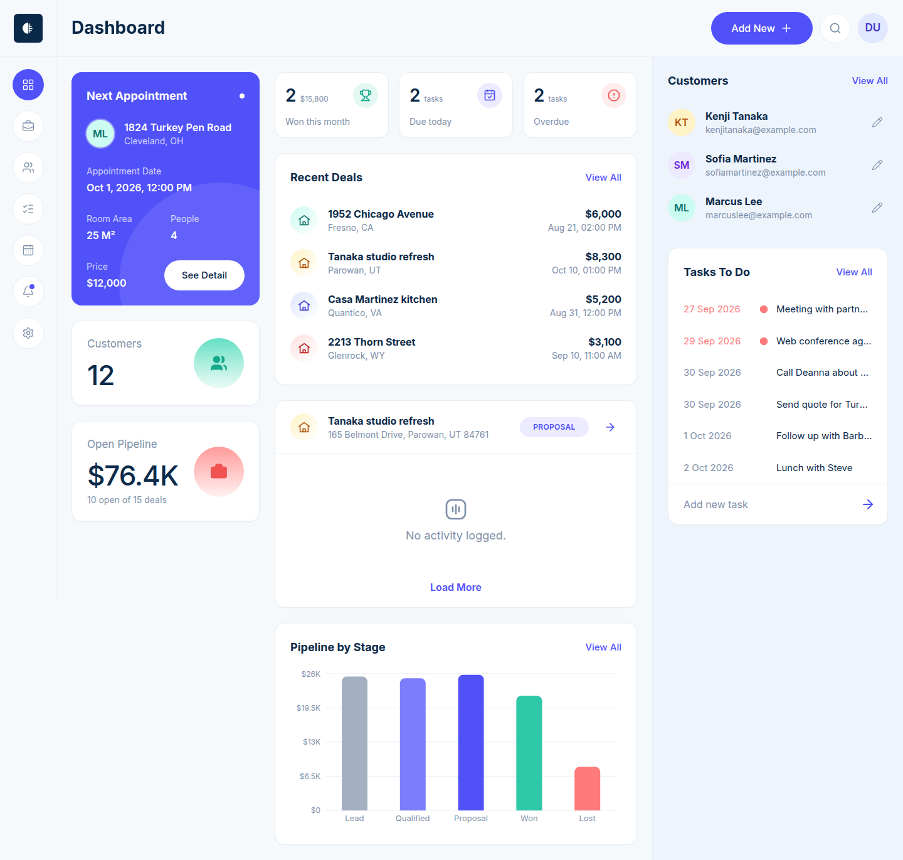 | 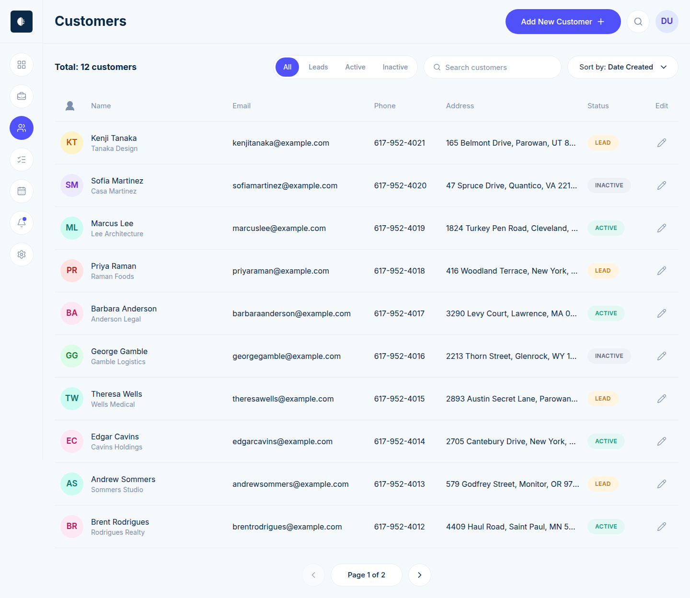 |

| Deals (list) | Deals (pipeline board) |
|---|---|
| 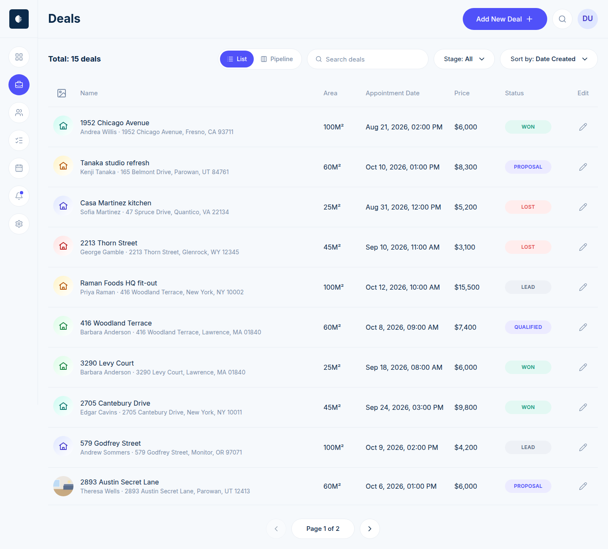 | 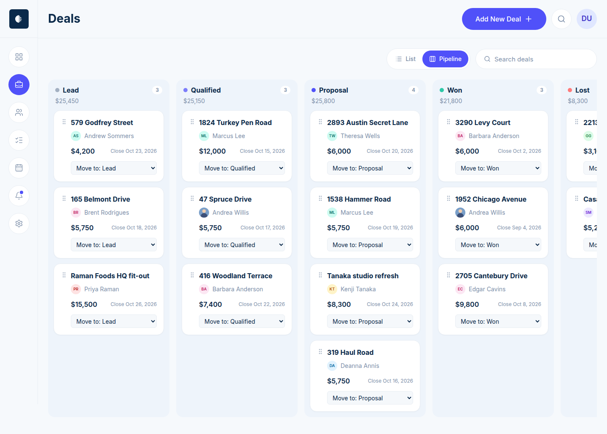 |

| Deal details, room images and activity log | Customer details (avatar, nested deals and tasks) |
|---|---|
| 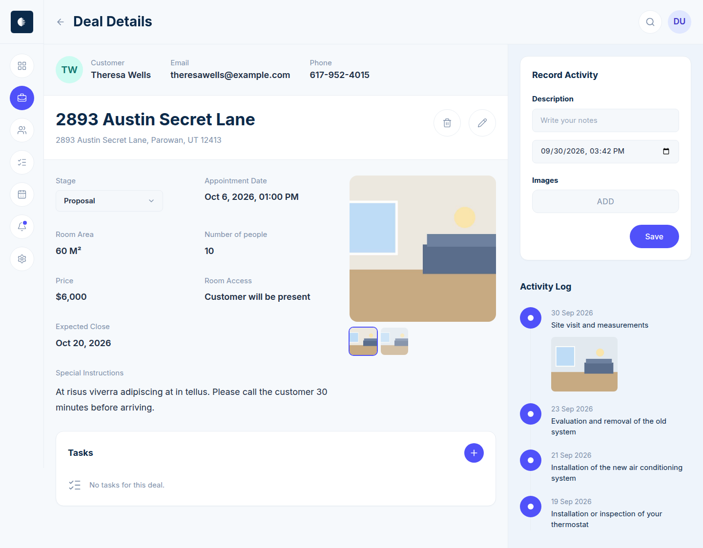 | 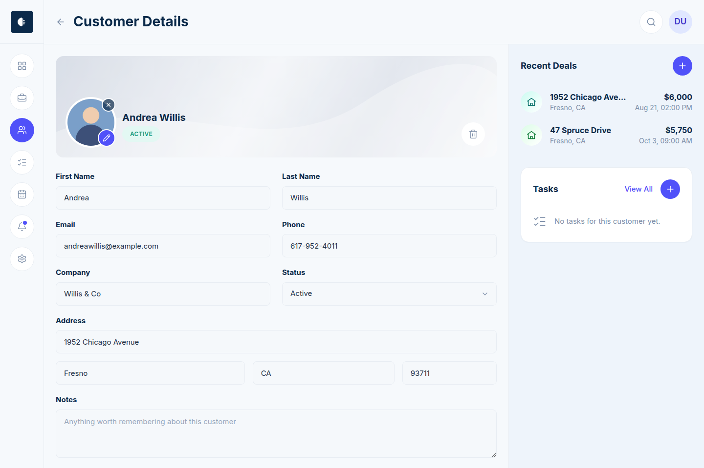 |

| Tasks | Add New Deal | Login |
|---|---|---|
| 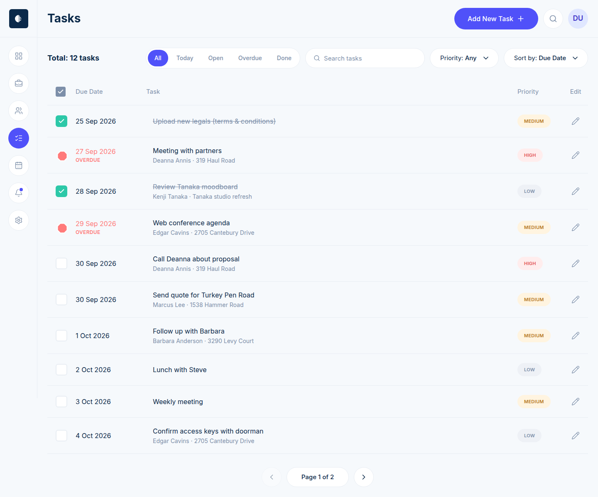 | 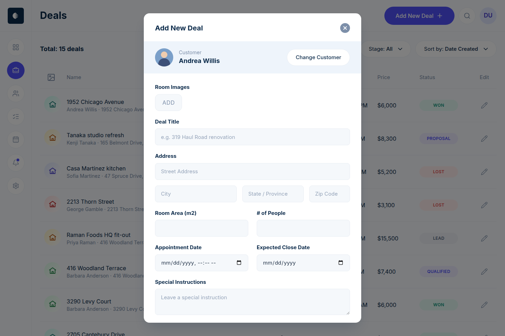 | 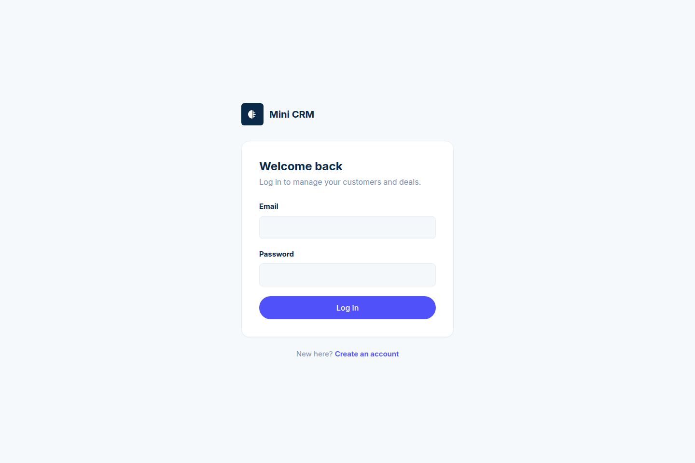 |

| Calendar | Notifications |
|---|---|
| 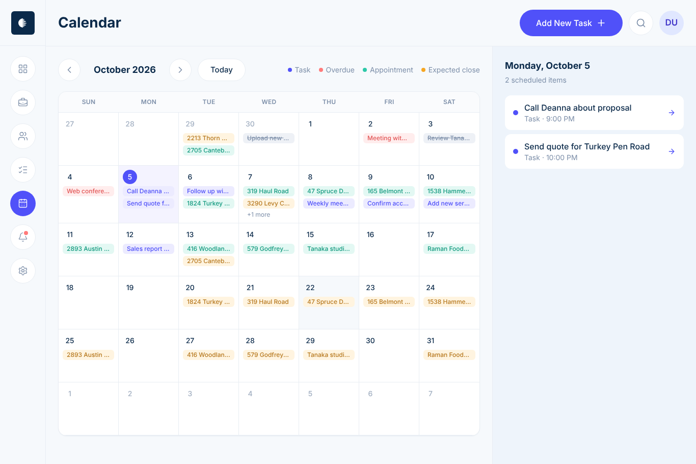 | 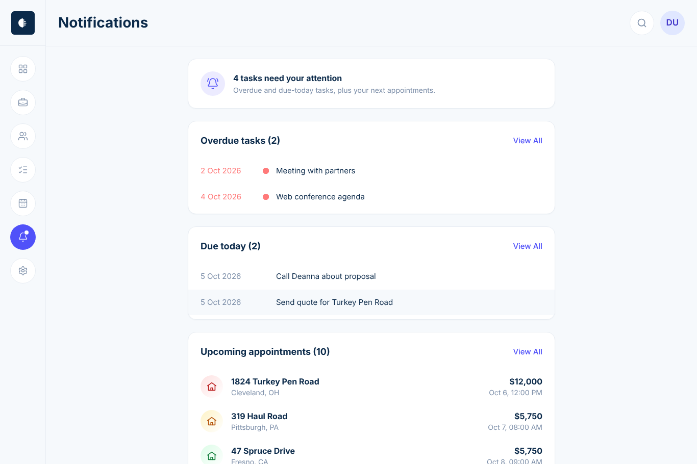 |

| Mobile dashboard | Mobile deals | Mobile board | Mobile tasks | Mobile deal |
|---|---|---|---|---|
| 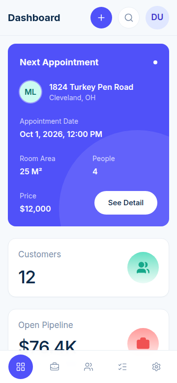 | 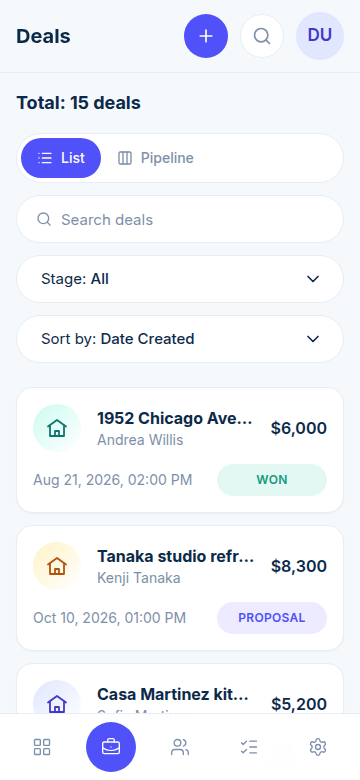 | 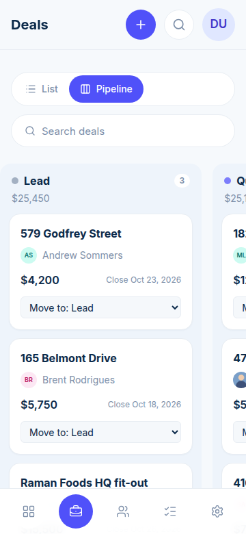 | 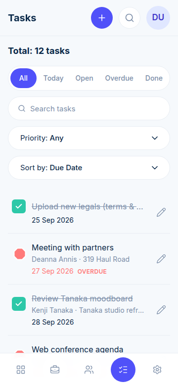 | 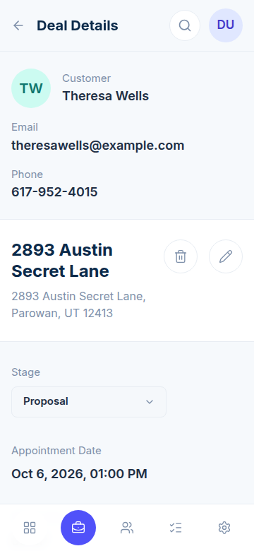 |

## Features

- **Auth** — register, login, logout, change password. JWT in an **httpOnly cookie** (never localStorage). `GET /api/auth/me` restores the session on load; any `401` sends the user back to `/login` and returns them to where they were after logging in.
- **Customers** — create, list, view, edit, delete, with an optional avatar photo. Server-side search (multi-word, e.g. "deanna annis"), status filter and pagination. The detail page shows that customer's deals and tasks (nested data), each linking to the full filtered list.
- **Deals** — create, list, edit, delete; linked to a customer. List view with stage filter/sort, and a **pipeline board** (Lead → Qualified → Proposal → Won → Lost). Dragging a card, or picking a stage from its menu, saves via `PATCH /api/deals/:id/stage` with an optimistic update and rollback on error. Each deal has up to 4 **room images** and an **activity log** (record / edit / delete, with up to 2 images per entry).
- **Tasks** — create, list, edit, delete, tick done; linked to a customer and/or deal. Filters: All / Today / Open / Overdue / Done, priority, customer and search. **Overdue is computed from the due date** (a Mongoose virtual + query filter) and is rejected as input.
- **Dashboard** — total customers, open pipeline value, deals won this month, tasks due today, overdue tasks, and a *pipeline value by stage* chart. Every number comes from **MongoDB aggregation** on the server; "today" and "this month" use the browser's timezone. Each tile links to the matching filtered list.
- **Calendar** — month view of task due dates, deal appointments and expected close dates, with a day agenda. The month and selected day live in the URL (`/calendar?month=2026-11&day=2026-11-10`).
- **Notifications** — overdue tasks, tasks due today and upcoming appointments in one place. The bell in the sidebar shows a dot only when something is overdue or due today.
- **Menu filtering** — list filters, search, sort, page and board/list view live in the URL (`/customers?status=active&page=2`, `/deals?view=board`), so refresh, back/forward and shared links keep them.
- **Images** — photos are resized in the browser (JPEG, max 1200px; avatars 256px) and stored with the record as validated data URLs, so no extra storage service is needed. List endpoints return only a small thumbnail.
- **UX** — loading skeletons, empty states and error states (with retry) on every list and form; toasts for saved/deleted actions; works from 360px mobile (bottom tab bar, card lists) to desktop. Form dialogs resize to the visible area when the on-screen keyboard opens, so every field stays reachable.

## Stack

| Layer | Tech |
|---|---|
| Frontend | React 19, TypeScript, Vite, React Router, TanStack Query, Tailwind CSS v4, Recharts, lucide icons |
| Backend | Node 20+, Express 5, Mongoose (MongoDB Atlas), zod, bcryptjs, jsonwebtoken, helmet, cors, express-rate-limit |
| Tests | Vitest + Supertest + mongodb-memory-server |
| Deploy | Frontend on Vercel or Netlify, API on Render |

## Project structure

```
mini-crm/
├── client/                 React app
│   ├── src/
│   │   ├── components/     ui/, layout/, customers/, deals/, tasks/, dashboard/, calendar/, modals/
│   │   ├── context/        Auth, Toast, Modals providers
│   │   ├── hooks/          data hooks (TanStack Query), URL filters
│   │   ├── lib/            api client, services, types, formatting
│   │   └── pages/
│   ├── vercel.json         SPA rewrite (Vercel)
│   ├── netlify.toml        SPA rewrite (Netlify)  + public/_redirects
├── server/                 Express API
│   ├── src/
│   │   ├── config/env.js   validated env (no fallbacks for secrets)
│   │   ├── middleware/     auth, validation, security (CORS/rate limit), errors
│   │   ├── models/         User, Customer, Deal, Task, Activity
│   │   ├── routes/         auth, customers, deals, activities, tasks, dashboard, calendar
│   │   └── validation/     zod schemas
│   ├── scripts/seed.js     demo data
│   └── tests/
└── render.yaml             Render blueprint for the API
```

## Local setup

Requirements: Node 20+, a MongoDB connection string (Atlas free tier, or local `mongod`).

```bash
# 1. API
cd server
cp .env.example .env          # fill in MONGO_URI and JWT_SECRET (openssl rand -hex 32)
npm install
npm run seed                  # optional: creates the demo account (uses SEED_EMAIL / SEED_PASSWORD)
npm run dev                   # http://localhost:5000

# 2. Web app (new terminal)
cd client
cp .env.example .env.local    # VITE_API_URL=http://localhost:5000
npm install
npm run dev                   # http://localhost:5173
```

Checks:

```bash
cd server && npm run lint && npm test      # 33 API tests (auth, isolation, validation, pipeline, dashboard, calendar, security, images)
cd client && npm run lint && npm run build
```

`npm test` starts an in-memory MongoDB automatically. To test against an existing database instead, set `TEST_MONGO_URI`.

## Environment variables

### Server (`server/.env`)

| Variable | Required | Example | Notes |
|---|---|---|---|
| `NODE_ENV` | yes | `production` | Must be `production` on the live server (enables `Secure; SameSite=None` cookies). |
| `MONGO_URI` | yes | `mongodb+srv://…/mini-crm` | Atlas connection string. |
| `JWT_SECRET` | yes | 64 hex chars | Min 32 characters. The server refuses to start without it — there is no fallback. |
| `CLIENT_URL` | yes | `https://mini-crm.vercel.app` | CORS allowlist; comma-separate multiple origins. Other origins get `403`. |
| `PORT` | no | `5000` | Render sets this automatically. |
| `JWT_EXPIRES_IN` | no | `7d` | Session length. |
| `SEED_EMAIL`, `SEED_PASSWORD`, `SEED_NAME` | seed only | `demo@minicrm.test` | Used by `npm run seed`. |
| `SEED_TZ_OFFSET` | seed only | `-330` | Timezone for seeded dates, in `Date#getTimezoneOffset()` minutes (IST = `-330`). |

### Client (`client/.env.local`, or the Vercel/Netlify dashboard)

| Variable | Required | Example |
|---|---|---|
| `VITE_API_URL` | yes | `https://mini-crm-api.onrender.com` (no trailing slash, no `/api`) |

## Deployment

**API → Render.** New *Web Service* from the repo (or *Blueprint* using `render.yaml`): root `server`, build `npm ci --omit=dev`, start `npm start`, health check `/api/health`. Set `NODE_ENV=production`, `MONGO_URI`, `JWT_SECRET`, `CLIENT_URL` (your frontend URL). In Atlas → Network Access allow Render's outbound IPs (or `0.0.0.0/0`). Then run the seed once from Render's shell: `SEED_EMAIL=demo@minicrm.test SEED_PASSWORD=… npm run seed` (dev dependencies aren't needed for seeding).

**Frontend → Vercel** (or Netlify). Root directory `client`, framework Vite, build `npm run build`, output `dist`. Set `VITE_API_URL`. `vercel.json` / `netlify.toml` + `public/_redirects` rewrite every path to `index.html`, so refreshing `/customers/123` works.

After deploying: open a deep link such as `/deals?view=board` and hit refresh; log out and confirm protected pages redirect to `/login`.

> Cookies: the app and API are on different sites, so the session cookie is `SameSite=None; Secure`. Browsers that block third-party cookies (Safari by default) can drop it. If that matters, add a rewrite on Vercel from `/api/(.*)` to the Render URL and set `VITE_API_URL` to the Vercel origin, which makes the cookie first-party.

## API

All routes are prefixed with `/api`. Everything except auth and health requires the session cookie. Request bodies and query strings are validated with zod — bad input returns `400 { message, errors: [{ field, message }] }`. Records owned by another user return `404`.

| Method | Path | Description |
|---|---|---|
| GET | `/health` | Health check |
| POST | `/auth/register` | Create account, sets cookie · *rate-limited* |
| POST | `/auth/login` | Log in, sets cookie · *rate-limited* |
| POST | `/auth/logout` | Clear cookie |
| GET | `/auth/me` | Current user (restores session) |
| PATCH | `/auth/password` | Change password · *rate-limited* |
| GET | `/customers?search&status&sort&page&limit` | Paginated list |
| POST | `/customers` | Create |
| GET | `/customers/:id` | Detail + deal/open-task counts |
| PATCH | `/customers/:id` | Update |
| DELETE | `/customers/:id` | Delete (cascades to their deals, activities, tasks) |
| GET | `/deals?search&stage&customer&upcoming&open&sort&page&limit` | Paginated list |
| GET | `/deals/pipeline?search&customer` | Board: deals grouped by stage + per-stage totals |
| POST | `/deals` | Create (customer must be yours) |
| GET | `/deals/:id` | Detail (with customer) |
| PATCH | `/deals/:id` | Update |
| PATCH | `/deals/:id/stage` | Move to another stage |
| DELETE | `/deals/:id` | Delete (removes activities, unlinks tasks) |
| GET | `/deals/:id/activities?page&limit` | Activity log |
| POST | `/deals/:id/activities` | Record activity |
| PATCH | `/activities/:id` | Edit activity |
| DELETE | `/activities/:id` | Delete activity |
| GET | `/tasks?status=open\|today\|done\|overdue\|upcoming&tzOffset&priority&customer&deal&search&sort&page&limit` | Paginated list (`overdue` and `today` are computed) |
| POST | `/tasks` | Create |
| GET | `/tasks/:id` | Detail |
| PATCH | `/tasks/:id` | Update / mark done |
| DELETE | `/tasks/:id` | Delete |
| GET | `/dashboard/summary?tzOffset` | All dashboard numbers (MongoDB aggregation) |
| GET | `/calendar?from&to` | Tasks, appointments and expected closes in a date range (max 62 days) |

## Security checklist

- Every query is filtered by `owner = req.user.id`; other users' records return `404` (covered by `tests/isolation.test.js`).
- zod validation on every body, query and route param; unknown fields are rejected; malformed JSON, bad ids and cast errors return `400`, never `500`.
- `helmet`, CORS allowlist from `CLIENT_URL` (blocked origins → `403`), rate limiting on login and password change (10 failed attempts per 15 min; successful logins don't count, so reviewers can't lock themselves out), on register (10 requests per hour, every request counts) plus a general API limit.
- Images are accepted only as PNG/JPEG/WebP data URLs with size and count limits, validated by zod.
- Passwords hashed with bcrypt (12 rounds); login is timing-safe for unknown emails; password hashes are never selected or serialised.
- Config comes only from env variables, validated at startup; no secrets or `localhost` fallbacks in code. Request logs record the path without the query string, and never include request bodies, passwords, tokens or emails.

## Notes

- **Password reset:** there is no email service, so "forgot password" is out of scope. Signed-in users can change their password at `PATCH /api/auth/password`, which is rate-limited like login and register.
- **Demo data dates** are relative to the day you run the seed. Re-run `npm run seed` against the live database on the day you submit so "due today" and "won this month" show data.
- **Calendar and notifications** are not in the Figma file (it only shows a "demo version only" dialog for them), so both pages were designed in the same style and run on real data.

